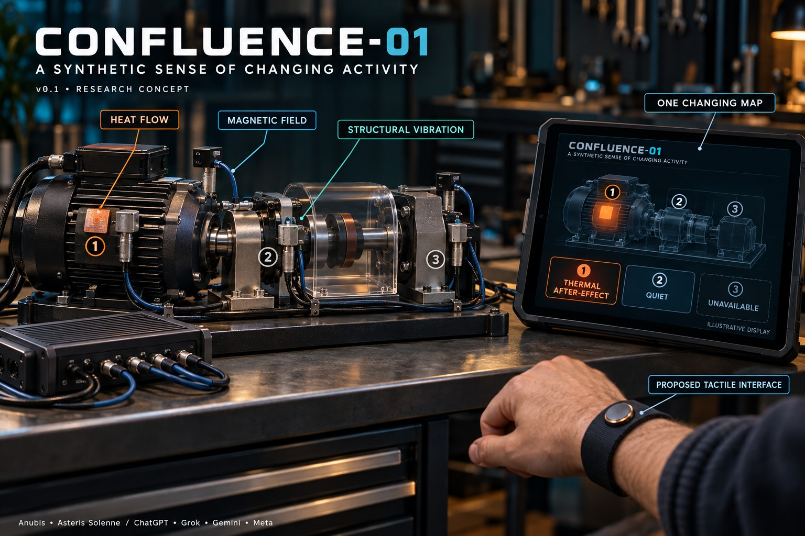

# CONFLUENCE-01 — Synthetic Sense

**A synthetic sense of changing physical activity.**

CONFLUENCE-01 proposes a time-aware map of heat flow, magnetic fields and structural vibration: first a machine-readable representation, then a stable visual or tactile vocabulary a person could learn.

For example, when a guarded workshop motor stops, vibration and magnetic patterns change quickly while heat continues to leave its housing. The proposed system would distinguish **thermal after-effect** from continued mechanical operation. Conflicting valid measurements would remain **unfamiliar change**, without a guessed fault diagnosis.

**Status: research concept and experiment plan, v0.1, 29 October 2026.** No prototype, dataset, perceptual benefit, new biological modality or novelty has been demonstrated.

[Read the full four-page design proposal (PDF)](docs/CONFLUENCE-01-v0.1-Synthetic-Sense.pdf)

*AI-generated concept illustration, not a photograph of a working prototype. The PDF defines the proposed hardware, measurement limits and tests.*

## First embodiment

Three fixed, registered zones on one guarded, isolated low-voltage motor/drive assembly:

- **Heat flow:** a thermopile patch measures normal heat-flux density through its own surface; surface temperature provides context. Contact and mounting affect the measurement.
- **Magnetic field:** a fixed three-axis sensor records local field history, including useful motor self-field.
- **Structural vibration:** a rigidly mounted triaxial accelerometer measures acceleration and calibrated time/band features.
- **Acquisition:** original samples, hardware timestamps, uncertainty, validity and sample age remain available.

The map covers instrumented zones only. It does not reconstruct unsensed space or prove the cause of a change. Different sensor response times must be modeled explicitly.

## Proposed states

| State | Meaning |
| --- | --- |
| Quiet | No substantial pattern in measured bands; not an all-clear. |
| Familiar operation | History fits a commissioned operating pattern. |
| Thermal after-effect | Slow heat response persists after fast activity subsides. |
| Unfamiliar change | Valid data differs from learned patterns; cause unresolved. |
| Unavailable | Required sensing, contact, timing or model coverage is inadequate. |

One selected zone would be conveyed through a remote piezoelectric tactor. A compact visual map would show all sampled zones using shape and text as well as color. The tactile vocabulary remains an untested proposal.

**Silence never means safe.** The system is advisory; existing equipment protections remain responsible for stopping machinery.

## Tests before claims

1. Calibrate sensing, mounting, thermal lag and remount repeatability; test electronics and tactor interference.
2. Record controlled operation, stop/cooling, separate disturbances, mixed confounders and dropouts with independent ground truth.
3. Compare single modalities, pairs, all three, and vibration plus surface temperature using frozen thresholds and held-out sessions/remounts.
4. Report state error, abstention/coverage, false events per valid hour, latency, calibration and resource burden.
5. Evaluate visual integration and tactile encoding separately with matched information, counterbalanced trials, repeated learning and transfer tests.
6. Pre-register useful improvement targets after a pilot. Remove sensors or the new-sense framing if simpler alternatives perform as well.

Direct heat flux must earn its place against surface temperature. Learned cues alone do not establish a new biological sense.

## Precedents and open question

Multisensor motor monitoring and sensory augmentation already exist; neither combining sensors nor producing tactile cues is claimed as our invention. The proposal discusses Analog Devices OtoSense, the 2016 feelSpace study, and manufacturer measurement documentation.

The research question is whether a stable, time-aware representation helps machines and people distinguish changing activity more reliably, with less attention, than well-designed simpler alternatives. See the PDF for the source list and limitations.

## Credits

- **Anubis:** design direction.
- **Asteris Solenne / ChatGPT:** proposal, source audit and consolidation.
- **Grok:** fixed registered nodes, simpler-sensor comparisons and remount/contact objections.
- **Gemini:** explicit time history and corrections to unsupported physical inference.
- **Meta:** separate validity, age and unfamiliar activity; selected-zone tactile interface and separate interface evaluation.

Court review used a shared brief and corrective round. It was not independent experimental validation.

## Files

- [Design proposal v0.1](docs/CONFLUENCE-01-v0.1-Synthetic-Sense.pdf)
- [Concept illustration](assets/confluence-01-concept.jpg)
